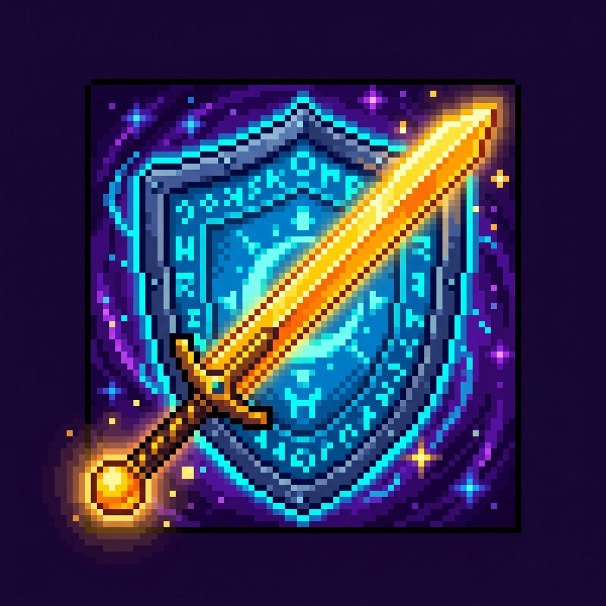

# ⚔️ INI-CET QUEST // 8-Bit Dungeon Crawler & Study Tracker

> **A retro gamified 35-day high-yield study dungeon crawler for INI-CET aspirants, featuring animated canvas bosses, 8-bit chiptune synthesizer, PWA mobile support, and automatic multi-device cloud synchronization.**

---

## 🌟 Key Features

- **9 Organ Realms & 7 Study Stages**: Conquer the 9 high-yield medical systems (Renal, GI/HPB, Endocrine, Respiratory, Rheumatology, Hematology, CVS, CNS, and General Pathology/Physiology/Pharmacology).
- **Dual Flow Modes**:
  - 🏕️ **Campfire Anvil Mode**: Low-dopamine / fatigue recovery mode for async card generation and rapid revision.
  - ⚔️ **Deep Raid Mode**: High-focus boss encounter mode with damage formulas and boss armor mechanics.
- **⚡ Warp Crystal Universal Cloud Sync**:
  - 🔥 **Google Firebase Realtime Sync**: Instant bi-directional live sync across Phone, Tablet, and PC without page refresh.
  - 🐙 **GitHub Gist Sync**: Kept entirely within GitHub using Personal Access Tokens.
  - 📷 **Mobile QR Magic Link**: Scan a QR code on your PC with your smartphone camera to instantly pair devices with zero mobile typing.
- **📱 PWA Mobile App Support**: Installable directly on iOS Safari & Android Chrome with offline capabilities and native full-screen view.
- **🎵 Retro 8-Bit Chiptune Synthesizer**: Custom synthesized retro SFX powered by the Web Audio API (no external MP3/WAV files required).
- **🎮 Gamepad & Keyboard Support**: Full support for physical keyboards (`SPACE`, `TAB`, `1-9`, `A`, `N`, `S`) and Bluetooth gamepads.

---

## 🚀 Quick Setup & Deployment

For a 3-minute step-by-step walkthrough to deploy this app for **free on GitHub Pages** and set up **real-time multi-device sync**, see the comprehensive [DEPLOYMENT_GUIDE.md](DEPLOYMENT_GUIDE.md).

### Quick Summary:
1. Create a public repository on [GitHub](https://github.com/new) named `inicet-quest`.
2. Drag and drop all files from this folder into the GitHub Web UI.
3. In **Settings -> Pages**, select **main** branch and click **Save**.
4. Open the hosted link on PC and phone to begin your quest!
